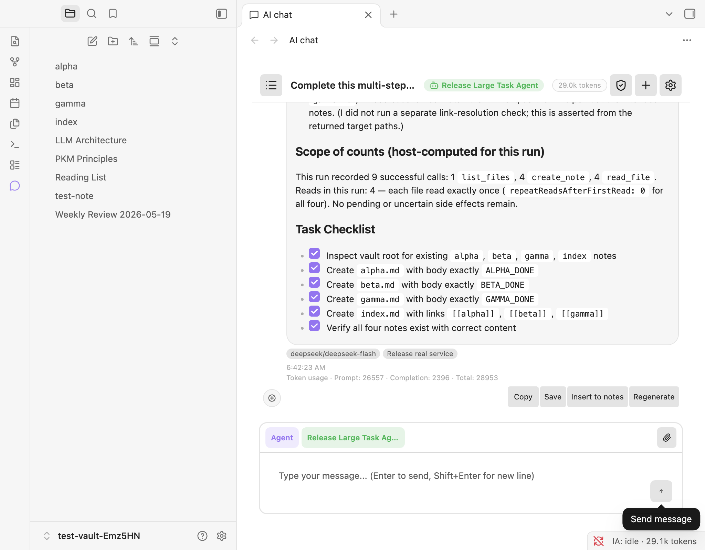
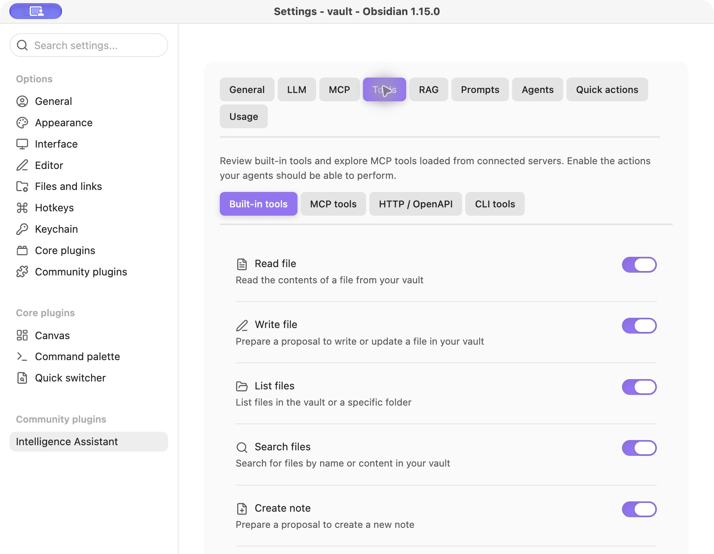
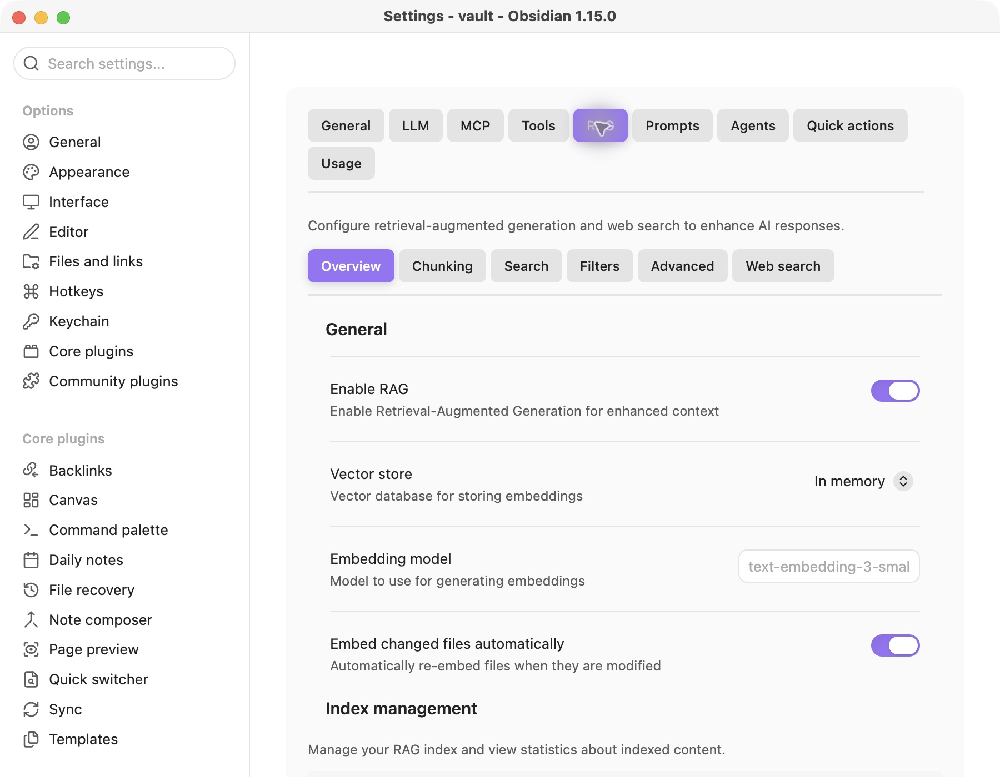

<div align="center">

<h1>🧠 Intelligence Assistant</h1>
<p><strong>让笔记、模型与工具，在 Obsidian 中协作。</strong></p>
<p>聊天、检索知识库，并让智能体完成多步骤任务。</p>

<p>
  <a href="https://github.com/qwai-tech/obsidian-plugin-intelligence-assistant/actions/workflows/ci-cd.yml"></a>
  <a href="docs/releases/0.1.0.md"></a>
  
  
</p>

<p><a href="README.md">English</a> · <a href="#installation">安装</a> · <a href="docs/user-guide-zh.md">使用指南</a> · <a href="docs/README.md">文档</a></p>

</div>

**仅桌面端** · 模型、工具和知识库，在一个工作区中使用。



<p align="center"><em>从请求到实际笔记：多步骤执行、结果核验与清晰的任务记录。</em></p>

<a id="features"></a>

## ✨ 功能

- **💬 聊天与智能体**：流式回复、笔记/文件夹引用、依赖模型能力的图片输入、可复用提示词，以及 Librarian、Architect、Researcher、Scribe 智能体预设。
- **🧰 知识库工具**：13 个内置工具，覆盖文件读取/列举/搜索、笔记创建/更新/追加、属性、Canvas、PDF、标签和链接。参见[工具参考](docs/user-guide-zh.md#内置工具)。当前没有内置的移动或删除工具。
- **📝 写入提案**：内置智能体写入默认生成可审阅的提案。智能体启用“自主写入”且任务经过宿主授权时，可在运行中应用提案。
- **⏯️ 手动续跑**：点击 **Stop** 后，在同一会话发送 `Continue.`，重载 Obsidian 后也可如此操作。保存的任务上下文和工具证据用于续跑；这不等同于自动崩溃回放，也不保证外部动作恰好执行一次。
- **📚 知识与记忆**：可选 RAG、本地索引、可配置的嵌入提供商、来源引用，以及每个智能体的无记忆、短期或长期记忆模式。
- **🔌 外部集成**：MCP stdio 服务器、OpenAPI HTTP 工具和本地 CLI 工具。网络搜索有八种可配置后端，所需凭据、地址及可用性因后端而异。
- **🌐 模型提供商**：OpenAI、Anthropic、Google Gemini、DeepSeek、OpenRouter、Ollama、SAP AI Core，以及兼容 OpenAI 的自定义端点。工具调用和图片输入取决于实际模型及服务。
- **🎨 界面**：九个顶部设置 Tab、浅色/深色主题，以及 49 个内置界面语言包。

<a id="screenshots"></a>

## 🖼️ 界面一览

<table>
  <tr><th>按需授予工具权限</th><th>配置知识库检索</th></tr>
  <tr>
    <td width="50%"><a href="docs/images/tool-permissions.jpg"></a></td>
    <td width="50%"><a href="docs/images/rag-settings.jpg"></a></td>
  </tr>
</table>

以上均为真实 Obsidian 界面截图。[截图来源与验证范围](docs/images/README.md)。

<a id="installation"></a>

## 📦 安装

### 社区插件

1. 打开 **设置 → 第三方插件 → 浏览**。
2. 搜索 **Intelligence Assistant**，安装并启用。
3. 在 **设置 → Intelligence Assistant → 通用** 中确认安装的版本。

插件已列入[官方社区目录](https://github.com/obsidianmd/obsidian-releases/blob/master/community-plugins.json)。社区安装取得的是已发布的版本，可能与当前检出的源码不同。已发布文件见 [Releases](https://github.com/qwai-tech/obsidian-plugin-intelligence-assistant/releases)，0.1.0 的发布进度与验证范围见[版本记录](docs/releases/0.1.0.md)。

### 从源码或发布文件安装

构建当前源码时，使用 Node.js 22 和仓库中的锁文件：

```bash
git clone https://github.com/qwai-tech/obsidian-plugin-intelligence-assistant.git
cd obsidian-plugin-intelligence-assistant
npm ci
npm run build:production
```

把 `main.js`、`styles.css`、`manifest.json` 复制到 `<库配置目录>/plugins/intelligence-assistant/`。库配置目录通常是库内的 `.obsidian`。重载 Obsidian 并启用插件。升级前备份知识库，只替换这三个程序文件，保留 `data.json` 和插件的 `data/` 文件夹。

<a id="first-setup"></a>

## 🚀 首次配置

1. 打开 **设置 → Intelligence Assistant → LLM → 提供商**，新增提供商并选择 Obsidian 钥匙串中的对应凭据。自定义端点还可能需要基础 URL。
2. 测试连接，在 **LLM → 模型** 中检查并启用可用的聊天模型，设置默认模型。端点可连接但没有可用模型，不代表能够正常生成回复。
3. 从功能区或命令面板打开 AI 聊天，先发送一个简短请求。
4. 使用工具前切换至 **Agent** 模式，在“智能体”设置中检查模型策略、工具权限、步数/输出预算及写入设置。
5. 按需配置 RAG、记忆、网络搜索及外部工具，详见[使用指南](docs/user-guide-zh.md)。

SAP AI Core 使用存有完整 Service Key JSON 的钥匙串条目，以及资源组（通常为 `default`）。AI API 地址默认来自 `serviceurls.AI_API_URL`，也可覆盖。连接测试用于发现运行中的部署。SAP 代码已包含在本版本中，本次准备工作没有进行真实 SAP 租户调用。

<a id="permissions-and-data"></a>

## 🔐 权限与数据

内置智能体写入提案约束的是支持的知识库编辑。已配置的 CLI 命令、MCP 服务器和 HTTP 操作可以具有各自的文件、进程及网络副作用，不受提案界面的沙箱隔离。只向智能体授予所需工具。在提示词中写“无需确认”，本身不会启用自动写入。

| 功能 | 数据处理 |
|---|---|
| 聊天 / 智能体 | 提示词及包含的笔记、图片、检索上下文、已启用的记忆会发送给选定模型服务。是否在本机处理，取决于端点及其配置。 |
| RAG | 索引存放在本地，索引文本会发送给配置的嵌入提供商；可选模型评分也会产生模型请求。启用增量索引后，还可处理后续知识库变更。 |
| 网络搜索 | 根据原始用户输入生成的查询会发送给配置的搜索服务。 |
| 外部工具 | 参数传给配置的进程或端点，其具体实现决定访问范围和副作用。 |
| 存储 / 凭据 | 会话、设置、缓存和记忆保存在库的插件配置目录下。提供商密钥、SAP Service Key、网络搜索凭据字段和 OpenAPI 认证值使用 Obsidian SecretStorage 的密钥引用。任意 CLI/MCP 环境变量不会自动转存到钥匙串。 |

其他已启用的插件共享 Obsidian 宿主环境。工具权限和密钥引用不提供进程隔离，详见[数据与执行说明](docs/user-guide-zh.md#数据存储与凭据)。

<a id="long-tasks"></a>

## ⏱️ 长任务

模型说“已完成”，并不能独立证明所有产物都存在。请核对实际文件和执行记录。步数/输出预算及提供商超时仍然有效；被中断的外部操作在重试前可能需要检查。

任务级限制应使用准确工具名，例如 `Use only read_file;` 或 `No tools.`。它们会收窄已有权限，并在简短续跑后保留，不会授予新工具。当前支持的是有限指令语法，参见[续跑指南](docs/user-guide-zh.md#停止与续跑)。

已记录的 0.0.23 真实门禁完成了一次持续 40.525 分钟、包含 100 篇文章并使用真实文件测量工具的任务。0.1.0 版本变更进行了构建及真实安装/重载检查。两者的验证范围分别记录于 [0.1.0 验证说明](docs/releases/0.1.0.md)。

<a id="development"></a>

## 🛠️ 开发

```bash
npm ci
npm run dev                # 开发构建与监听
npm run lint
npm run typecheck
npm run build              # 开发构建
npm run build:production   # 生产构建及构建来源记录
```

`npm run verify`、Jest、任务测试和 CI E2E 包含 mock。禁止 mock 的发布检查应配置真实服务后运行 `npm run verify:release:real`，详见[测试文档](docs/reference/testing.md)。向 `main`/`master` 正常推送会触发已有的 **Build and Publish** 工作流：检查版本标签、构建、运行真实门禁，再自动创建 Release。发布由 CI-CD 完成；详见[发布流程](docs/reference/testing.md#ci-behavior-and-publication)。

<a id="documentation"></a>

## 📖 文档

| 文档 | 内容 |
|---|---|
| [使用指南](docs/user-guide-zh.md) / [User guide](docs/user-guide-en.md) | 配置、工具、权限、续跑和数据 |
| [文档目录](docs/README.md) | 当前指南和历史记录 |
| [架构总览](docs/architecture/overview-zh.md) | 运行时职责与契约 |
| [开发指南](docs/project/project-guide-zh.md) | 构建、持久化和扩展入口 |
| [源码导航](docs/reference/project-structure.md) | 源码职责与关键入口 |
| [测试文档](docs/reference/testing.md) | 真实/mock 测试及绑定构建的发布证据 |

欢迎[提交问题或功能建议](https://github.com/qwai-tech/obsidian-plugin-intelligence-assistant/issues)。请提供插件/Obsidian 版本、提供商和模型、复现步骤，以及已脱敏的日志。
