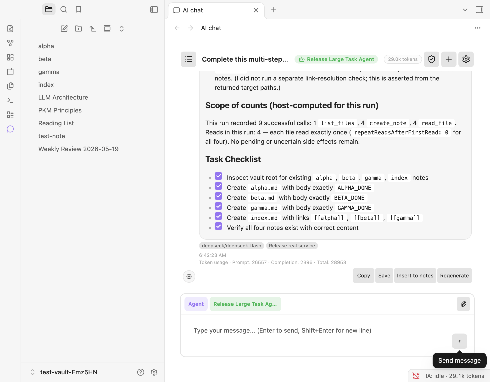
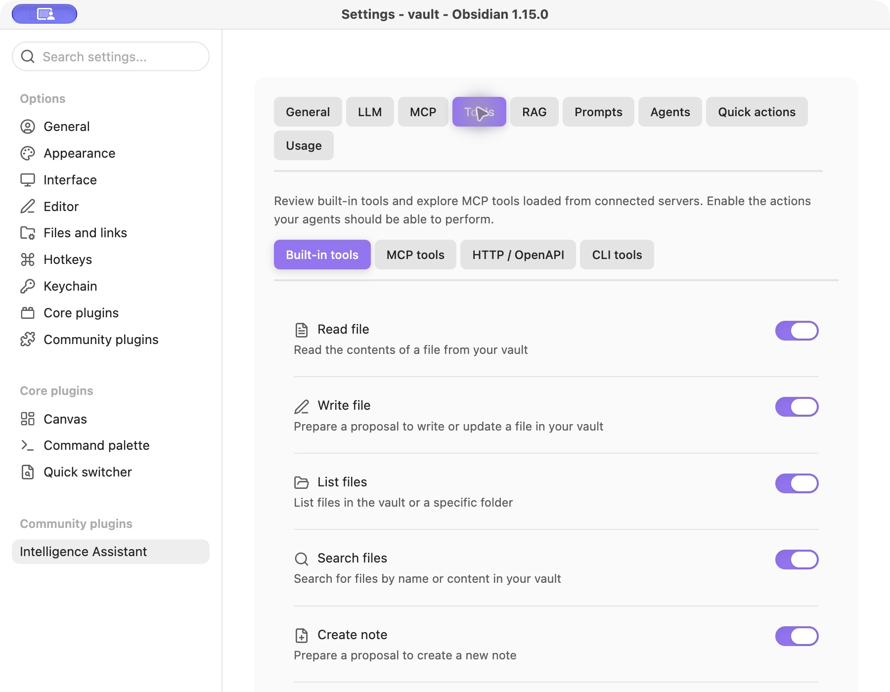
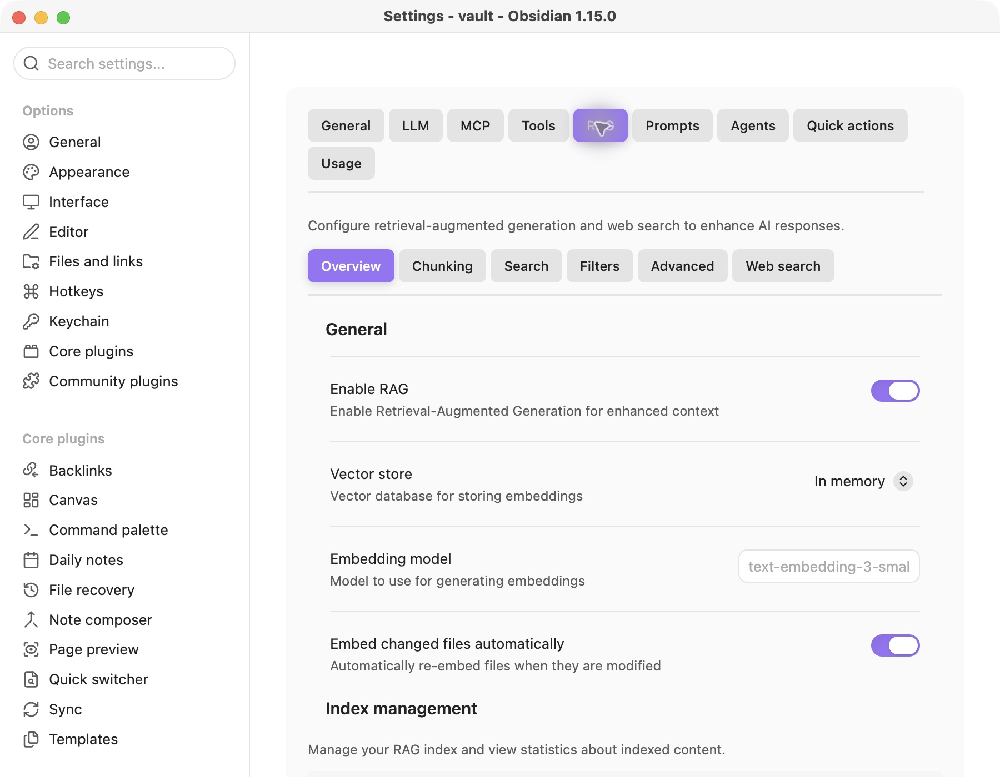

<div align="center">

<h1>🧠 Intelligence Assistant</h1>
<p><strong>Your notes. Your models. Your AI workspace.</strong></p>
<p>Chat with your notes, explore your vault, and let Agents work through multi-step tasks.</p>

<p>
  <a href="https://github.com/qwai-tech/obsidian-plugin-intelligence-assistant/actions/workflows/ci-cd.yml"></a>
  <a href="docs/releases/0.1.1.md"></a>
  
  
</p>

<p><a href="README-zh.md">简体中文</a> · <a href="#installation">Install</a> · <a href="docs/user-guide-en.md">User guide</a> · <a href="docs/README.md">Documentation</a></p>

</div>

**Desktop only** · Models, tools and vault context in one workspace.



<p align="center"><em>From a request to saved notes: tool use, verification and a visible task record.</em></p>

<a id="features"></a>

## ✨ Features

- **💬 Chat and Agents:** streaming responses, note/folder references, model-dependent image input, reusable prompts and Agent presets: Librarian, Architect, Researcher and Scribe.
- **🧰 Vault tools:** 13 built-in tools for reading, listing and searching files; creating, updating and appending notes; properties; Canvas; PDFs; tags and links. See the [tool reference](docs/user-guide-en.md#built-in-tools). Built-in move/delete tools are not included.
- **📝 Write proposals:** built-in Agent writes normally produce reviewable proposals. An approved task can apply them during execution when the Agent's **Autonomous write** setting is enabled.
- **⏯️ Manual continuation:** use **Stop**, then send `Continue.` in the same conversation, including after reloading Obsidian. Saved task context and tool evidence support continuation; this is not automatic crash replay or an exactly-once guarantee for external actions.
- **📚 Knowledge and memory:** optional RAG with a local index, a configurable embedding provider, source references, and per-Agent memory modes: none, short-term or long-term.
- **🔌 Integrations:** MCP stdio servers, OpenAPI HTTP tools and local CLI tools. Web search has eight configurable backends; credentials, endpoints and availability depend on the backend.
- **🌐 Models:** OpenAI, Anthropic, Google Gemini, DeepSeek, OpenRouter, Ollama, SAP AI Core and custom OpenAI-compatible endpoints. Tool calling and image support depend on the selected model and service.
- **🎨 Interface:** nine top-level settings Tabs, light/dark themes and 49 bundled UI locales.

<a id="screenshots"></a>

## 🖼️ A look inside

<table>
  <tr><th>Choose the tools your Agent can use</th><th>Configure retrieval for your vault</th></tr>
  <tr>
    <td width="50%"><a href="docs/images/tool-permissions.jpg"></a></td>
    <td width="50%"><a href="docs/images/rag-settings.jpg"></a></td>
  </tr>
</table>

Actual Obsidian captures. [Screenshot provenance and validation scope](docs/images/README.md).

<a id="installation"></a>

## 📦 Installation

### Community plugins

1. Open **Settings → Community plugins → Browse**.
2. Find **Intelligence Assistant**, install it and enable it.
3. Check **Settings → Intelligence Assistant → General** for the installed version.

The plugin is listed in the [official community registry](https://github.com/obsidianmd/obsidian-releases/blob/master/community-plugins.json). Community installation uses published release assets; it may install a different version from this checkout. See [Releases](https://github.com/qwai-tech/obsidian-plugin-intelligence-assistant/releases) for published assets, the [0.1.1 notes](docs/releases/0.1.1.md) for cumulative changes including 0.1.0, and the [0.1.0 record](docs/releases/0.1.0.md) for its original validation scope.

### From source or release files

To build this checkout, use Node.js 22 and the committed lockfile:

```bash
git clone https://github.com/qwai-tech/obsidian-plugin-intelligence-assistant.git
cd obsidian-plugin-intelligence-assistant
npm ci
npm run build:production
```

Copy `main.js`, `styles.css` and `manifest.json` into `<vault-config>/plugins/intelligence-assistant/` (`<vault-config>` is usually `.obsidian` inside your vault). Reload Obsidian and enable the plugin. For an upgrade, back up your vault and replace those three application files; retain `data.json` and the plugin's `data/` folder.

<a id="first-setup"></a>

## 🚀 First setup

1. Open **Settings → Intelligence Assistant → LLM → Providers**. Add the provider and select the appropriate credential from Obsidian's Keychain. Custom endpoints may also need a base URL.
2. Test the connection, review **LLM → Models**, enable an available chat model and set a default. A reachable endpoint with no usable models does not establish that generation works.
3. Open AI chat from the ribbon or command palette. Start with a short chat request.
4. For tool use, select **Agent** mode and review the Agent's model strategy, tools, step/output budgets and write setting under **Agents**.
5. Configure RAG, memory, web search and external tools only when needed. See the [user guide](docs/user-guide-en.md).

SAP AI Core uses a Keychain entry containing the complete Service Key JSON and a resource group (usually `default`). The AI API URL comes from `serviceurls.AI_API_URL` unless overridden. Connection testing discovers running deployments. SAP code is included, but this preparation did not perform a live SAP tenant test.

<a id="permissions-and-data"></a>

## 🔐 Permissions and data

Built-in Agent proposals govern supported vault edits. Configured CLI commands, MCP servers and HTTP operations can have their own filesystem, process and network effects; they are not sandboxed by the proposal UI. Grant an Agent only the tools it needs. Prompt text such as “without confirmation” does not by itself enable automatic vault writes.

| Feature | Data handling |
|---|---|
| Chat / Agent | Prompts and included notes, images, retrieved context and enabled memory are sent to the selected model service. A local endpoint keeps model processing local only if that service and its configuration do so. |
| RAG | The index is local. Indexed text is sent to the configured embedding provider; optional model grading also makes model requests. Enabled incremental indexing can process later vault changes. |
| Web search | Queries derived from the original user input go to the configured search service. |
| External tools | Tool arguments go to the configured process or endpoint, whose implementation determines its access and effects. |
| Storage / secrets | Conversations, settings, caches and memory are stored under the vault's plugin configuration directory. Provider keys, SAP Service Keys, web-search credential fields and OpenAPI authentication values use Obsidian SecretStorage references. Arbitrary CLI/MCP environment values are not automatically converted into Keychain secrets. |

Other enabled plugins share Obsidian's host environment. Tool permissions and secret references do not provide process isolation. See [data and execution details](docs/user-guide-en.md#data-storage-and-credentials).

<a id="long-tasks"></a>

## ⏱️ Long tasks

Agent completion text is not independent proof that every requested artifact exists. Check the actual files and execution trace. Step/output budgets and provider timeouts still apply; interrupted external operations may need inspection before retrying.

Use exact tool names for a task restriction, such as `Use only read_file;` or `No tools.`. These narrow configured permissions and survive a bare continuation. They do not grant new tools. The accepted directive grammar is intentionally limited; see the [guide](docs/user-guide-en.md#stop-and-continue).

The recorded 0.0.23 real gate completed a 40.525-minute task with 100 articles and a real file-measurement tool. The 0.1.0 version revision received build and actual installation/reload checks. These are separate scopes, documented in [0.1.0 validation](docs/releases/0.1.0.md).

<a id="development"></a>

## 🛠️ Development

```bash
npm ci
npm run dev                # development build and watch
npm run lint
npm run typecheck
npm run build              # development bundle
npm run build:production   # production bundle and provenance
```

`npm run verify`, Jest, missions and the CI E2E suite include mocks. For a no-mock release check, configure real services and use `npm run verify:release:real`; see [testing](docs/reference/testing.md). A normal push to `main`/`master` triggers **Build and Publish**: check the version tag, lint/type-check/build, verify artifact hashes, then create the Release automatically. The CI real-verification job is temporarily removed by explicit approval; the local real-test runner remains available. See the [release process](docs/reference/testing.md#ci-behavior-and-publication).

<a id="documentation"></a>

## 📖 Documentation

| Document | Contents |
|---|---|
| [User guide](docs/user-guide-en.md) / [中文指南](docs/user-guide-zh.md) | Setup, tools, permissions, continuation and data |
| [Documentation index](docs/README.md) | Current guides and historical records |
| [Architecture](docs/architecture/overview-en.md) | Runtime ownership and contracts |
| [Developer guide](docs/project/project-guide-en.md) | Builds, persistence and extension points |
| [Source map](docs/reference/project-structure.md) | Source ownership and entry points |
| [Testing](docs/reference/testing.md) | Real versus mock suites and artifact-bound release evidence |

[Issues and feature requests](https://github.com/qwai-tech/obsidian-plugin-intelligence-assistant/issues) are welcome. Include the plugin/Obsidian version, provider/model, steps to reproduce and redacted logs.
